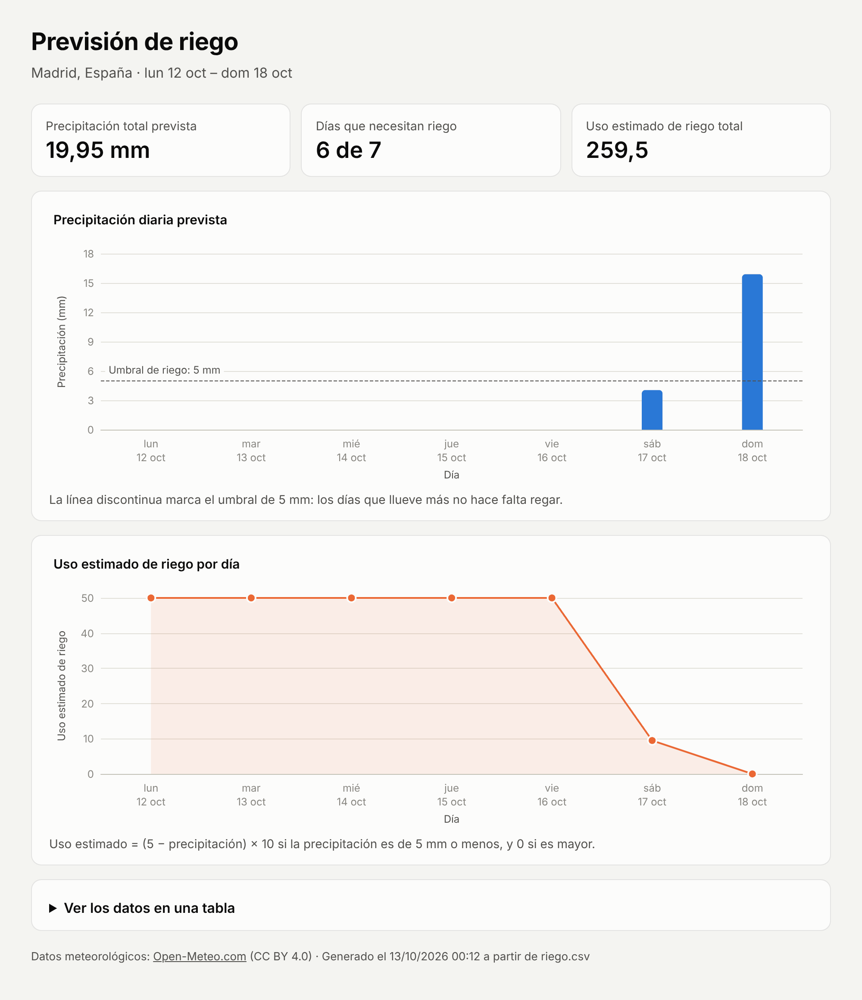

# Prueba 4 · Riego y dashboard

Obtiene la precipitación prevista para los próximos 7 días en una localidad, calcula el uso estimado de riego de cada día, lo guarda en un CSV y, a partir de ese CSV, genera un dashboard web con ECharts.



## Cómo se ejecuta

Requisitos: **Python 3.8 o superior** y conexión a internet. No hay que instalar ninguna librería.

```bash
python obtener_datos.py --ciudad Madrid                  # pasos 1-3 -> riego.csv
python generar_dashboard.py --ubicacion "Madrid, España"  # pasos 4-5 -> dashboard.html
```

Después basta con abrir `dashboard.html` en el navegador. En Windows, si `python` no funciona, prueba con `py`.

Si `riego.csv` cambia, se vuelve a ejecutar `python generar_dashboard.py` y el dashboard se actualiza. El HTML no se edita nunca a mano.

### Opciones

| Script | Opción | Para qué sirve |
|---|---|---|
| `obtener_datos.py` | `--ciudad NOMBRE` | Localidad que se consulta (por defecto, Madrid). |
| | `--pais ES` | Elige el país cuando hay ciudades con el mismo nombre. |
| | `--lat N --lon N` | Coordenadas en lugar del nombre. |
| | `--dias N` | Días de previsión, de 1 a 16 (por defecto, 7). |
| | `--salida RUTA` | CSV que se genera (por defecto, `riego.csv`). |
| `generar_dashboard.py` | `--csv RUTA` | CSV que se lee (por defecto, `riego.csv`). |
| | `--salida RUTA` | HTML que se genera (por defecto, `dashboard.html`). |
| | `--ubicacion TEXTO` | Localidad que aparece en la cabecera del dashboard. |

## Ficheros

```
obtener_datos.py          Pasos 1-3: API de Open-Meteo -> fórmula -> riego.csv
generar_dashboard.py      Paso 5: lee riego.csv y genera dashboard.html con la plantilla
plantilla_dashboard.html  Paso 4: el dashboard (HTML, CSS y ECharts), sin datos
test_riego.py             Pruebas automáticas
riego.csv                 Ejemplo: previsión real de Madrid consultada el 12/10/2026
dashboard.html            Dashboard generado a partir de ese CSV
captura_dashboard.png     La captura de arriba
```

## Cómo se cumple cada punto del enunciado

| Punto | Dónde | Cómo |
|---|---|---|
| 1. Precipitación de 7 días | `obtener_precipitacion()` | API de Open-Meteo, variable `precipitation_sum` (mm por día), `forecast_days=7`, con los días en la hora local de la localidad. El nombre de la ciudad se convierte en coordenadas con su API de geocodificación. |
| 2. Uso estimado | `calcular_uso_riego()` | `(5 - P) x 10` si P <= 5 mm; `0` si P > 5 mm. |
| 3. CSV | `guardar_csv()` | Columnas `Día`, `Precipitación (mm)` y `Uso estimado de riego`. |
| 4. Dashboard con ECharts | `plantilla_dashboard.html` | Arriba, la precipitación (barras); abajo, el uso estimado (línea). Las dos usan los mismos días en el eje X y tienen título y nombre en ambos ejes. |
| 5. Generación automática | `generar_dashboard.py` | Lee el CSV, lo valida y sustituye un marcador de la plantilla por los datos en formato JSON. |

## Decisiones técnicas

- **Open-Meteo** porque es gratuita, no necesita clave de API (para uso no comercial) y tiene geocodificación, así que se puede ejecutar sin registrarse. Su licencia (CC BY 4.0) pide citar la fuente, y por eso aparece en el pie del dashboard.
- **Solo biblioteca estándar** (`urllib`, `json`, `csv`, `argparse`): no hay nada que instalar.
- **Plantilla y datos separados.** La plantilla no contiene datos: el generador inserta un objeto JSON con los días y los valores. Así el HTML siempre sale del CSV.
- **Un único sitio para el formato.** Las columnas del CSV, el umbral (5 mm) y el factor (10) están definidos en `obtener_datos.py`, y el generador los importa de ahí.
- **Eje X compartido de verdad.** Las dos gráficas usan la misma lista de días y los mismos márgenes, así que cada día queda alineado verticalmente. Además, `echarts.connect()` sincroniza el tooltip: al pasar el ratón por un día se ve su valor en las dos gráficas.
- **Las dos gráficas se leen juntas.** La de precipitación marca el umbral de 5 mm con una línea discontinua, y la de uso tiene la escala fija de 0 a 50, que es el máximo que da la fórmula.
- **Redondeo.** En coma flotante, `(5 - 4.05) * 10` da `9.500000000000002`, así que el resultado se redondea a 2 decimales.
- **Un dato que falta no se convierte en 0.** Si la API no devuelve la precipitación de algún día, el script se detiene con un mensaje claro en vez de inventar un valor que falsearía el riego.
- **Unidades del uso.** El enunciado no las indica, así que se muestra sin unidad. Como referencia: 1 mm de lluvia equivale a 1 L/m², de modo que `5 - P` es lo que falta en L/m² para llegar a 5 mm, y el `x 10` es el factor del enunciado.
- **CSV pensado también para Excel.** Se guarda en UTF-8 con BOM para que Excel muestre bien las tildes. El generador acepta además el CSV tal como lo guarda Excel en español: separador `;`, coma decimal, fechas `dd/mm/aaaa` y codificación Windows-1252.
- **ECharts 6.1.0 desde el CDN de jsDelivr**, con hash de integridad (SRI) para que el navegador rechace el fichero si alguien lo modifica. Sin internet, la página lo avisa y el resumen y la tabla de datos siguen funcionando.
- **Presentación.** Modo claro y oscuro según el sistema, diseño adaptado al móvil, números en formato español, un resumen del periodo y una tabla con todos los valores (útil también para lectores de pantalla).

## Pruebas

```bash
python -m unittest -v
```

Son 16 pruebas y no necesitan internet, porque la API se sustituye por una respuesta real guardada. Cubren la fórmula (incluidos los casos límite de 0, 5 y 5,1 mm), la lectura de la respuesta de la API, el formato del CSV, los CSV guardados desde Excel, los errores en el CSV y la regeneración del HTML al cambiar el CSV.

## Problemas frecuentes

- **`CERTIFICATE_VERIFY_FAILED` en macOS:** ejecuta una vez `Install Certificates.command`, que está en la carpeta de Python dentro de Aplicaciones.
- **Excel muestra todo en una columna:** en español, Excel espera `;` como separador. Importa el CSV desde la pestaña *Datos* (opción *Desde texto/CSV*) y elige la coma como delimitador.
- **No aparecen las gráficas:** el dashboard carga ECharts desde internet; comprueba la conexión y recarga la página.
